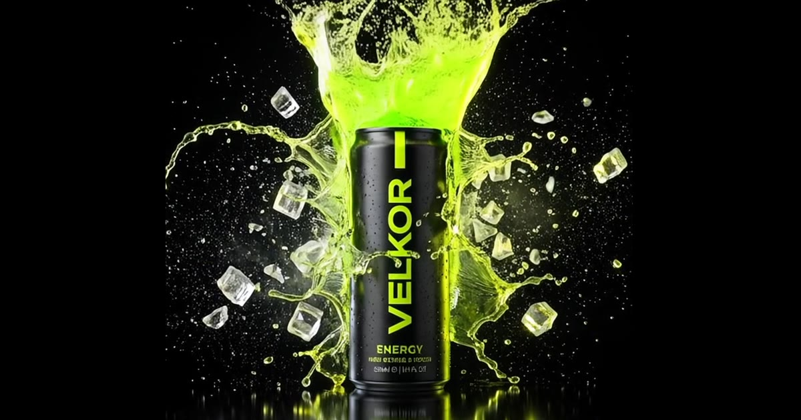

# VELKOR Energy

Landing page animada para uma bebida energética **fictícia**. Conforme a pessoa rola a página, a lata explode em líquido e gelo, quadro a quadro. É um projeto de portfólio: a marca não existe e nada está à venda.



**Lighthouse (build de produção):** Desempenho 99 · Acessibilidade 100 · Boas práticas 100 · SEO 100, no celular e no desktop.

## Rodando

```bash
npm install
npm run dev        # servidor de desenvolvimento
npm run build      # checa os tipos e gera /dist
npm run preview    # serve o /dist
npm run frames     # regenera quadros e imagens a partir de /source-assets
```

Abra com `?reduced-motion` no fim do endereço para ver a versão sem animação.

## Stack

- **Vite + TypeScript**, sem framework. Uma landing page não precisa de React, e o código fica mais leve.
- **GSAP + ScrollTrigger** para tudo que acompanha o scroll; **SplitText** para o manifesto palavra por palavra.
- **Lenis** para rolagem suave, sincronizada com o ScrollTrigger pelo ticker do GSAP.
- **Canvas 2D** para a sequência de quadros.
- **ffmpeg-static** (só em desenvolvimento) para extrair e otimizar os quadros.
- Imagens e vídeo gerados com IA (Gemini e Higgsfield).

## Decisões técnicas

### Sequência de quadros no canvas, em vez de `<video>`
Controlar `video.currentTime` pelo scroll trava, porque o navegador precisa decodificar a partir do último keyframe. Por isso o vídeo vira 141 imagens WebP, e o canvas desenha a imagem que corresponde à posição do scroll. O redesenho passa por `requestAnimationFrame`, no máximo uma vez por quadro de tela.

### Carregamento progressivo
Baixar 141 quadros antes de mostrar a página seria lento. A ordem de download é 1 a cada 8 quadros, depois 1 a cada 4, depois 2, depois todos. A tela de carregamento libera com cerca de 1/4 dos quadros. A animação já funciona inteira (o canvas usa o quadro carregado mais próximo) e fica mais lisa enquanto o resto chega. No celular ou com economia de dados, baixa só metade dos quadros. Ver [`src/frames.ts`](src/frames.ts).

### Duas fontes alinhadas pela lata
O hero começa com uma foto parada (16:9) e troca para o vídeo (quadrado), que têm enquadramentos diferentes. Medi a posição e a altura da lata em cada fonte, e o canvas escala as duas para a lata ocupar exatamente o mesmo lugar na tela. Um clarão verde cobre a troca. Ver [`src/hero-canvas.ts`](src/hero-canvas.ts).

### Bordas e marca d'água
O vídeo gerado tinha marca d'água no canto inferior. O script de extração recorta a faixa de baixo de cada quadro, e o canvas escurece as bordas da imagem com degradês para ela se dissolver no fundo preto em vez de mostrar um corte reto.

### Um sabor recolore a página inteira
Trocar o sabor muda a variável CSS `--accent` (botões, linhas, números) e aplica `hue-rotate` em todas as imagens marcadas com `data-tint`, inclusive o canvas do hero. Como a lata é preta, só a faixa colorida muda de cor.

### Sem conflito entre animações
- A entrada do hero anima só `clip-path`, `scale` e `x`; a timeline do scroll anima opacidade e `y`. Assim, rolar durante a entrada não faz uma sobrescrever a outra.
- O efeito magnético do botão usa `transform` (GSAP) e o estado pressionado usa a propriedade CSS `scale`, separada.

## Acessibilidade e resiliência

- `prefers-reduced-motion`: sem rolagem suave e sem pins, a lata aparece já explodida e todo o texto fica visível.
- Se a animação falhar ao iniciar (quadros que não carregam, por exemplo), a página cai numa versão estática e a loja continua funcionando. Sem JavaScript, um `<noscript>` esconde a tela de carregamento.
- Se a rede estiver muito lenta, a tela de carregamento libera depois de 12s com os quadros que já chegaram.
- Abas de sabor seguem o padrão WAI-ARIA (setas do teclado), com foco visível em todos os controles.
- No celular a lata inclina com o giroscópio; no desktop, com o mouse.

## Estrutura

```
source-assets/   arquivos brutos gerados com IA (não vão para o site)
scripts/         extração de quadros e otimização de imagens
public/frames/   141 quadros WebP + manifest.json
public/img/      imagens estáticas (com versões menores para o celular)
src/main.ts      boot, Lenis, timelines do GSAP
src/frames.ts    carregamento progressivo
src/hero-canvas.ts  desenho e alinhamento no canvas
src/shop.ts      sabores, carrinho, botão magnético
```

## Depois do deploy

Troque o `og:image` em `index.html` pelo endereço absoluto (`https://seu-dominio/og-image.jpg`). LinkedIn e WhatsApp não aceitam caminho relativo.
